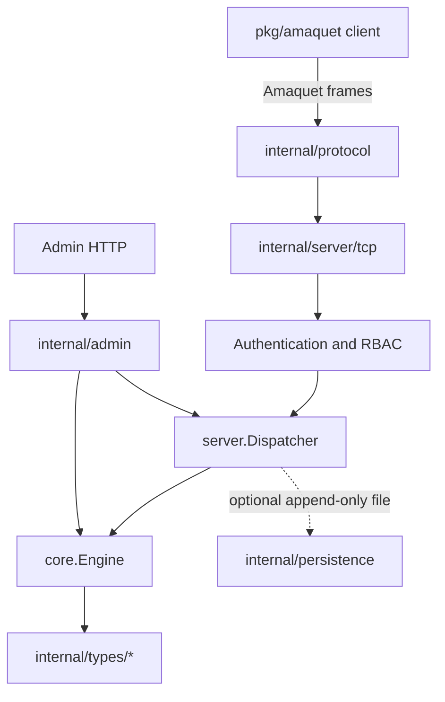

Amaquet separates protocol, authorization, dispatch, storage, value implementations, persistence, and administration.

## Components

Requests cross a small set of explicit package boundaries. Native clients use the framed protocol server, while HTTP administration requests reach the same dispatcher and engine through the control-plane package.

## Core engine

The keyspace is partitioned into 256 shards. FNV-1a hashes a key to a shard. Each shard contains a Go map and an `RWMutex`.

Read paths take a shard read lock. Set/update/delete/TTL paths take the shard write lock. Type implementations that can block or maintain their own synchronized state use internal locks and then call `BumpVersion` after mutation. This prevents a blocking queue or semaphore wait from pinning a whole keyspace shard.

## Type identity versus encoding

`core.DataType` is the stable type identity. The concrete Go object is the current internal encoding. This is important because an implementation can later replace an internal representation without changing the protocol-visible type name.

## Dispatcher

The dispatcher implements common commands (`SET`, `CREATE`, `GET`, `TYPE`, TTL operations, and so on) and a generic `OP` command for type-specific behavior. `CREATE` invokes the type factory; `SET` invokes typed decoding.

## Administration

The admin API does not have a separate database. Organization/member/API-key/RBAC/audit state is persisted to `data_dir/admin.json`; data commands run against the same in-memory `core.Engine` used by Amaquet clients.
