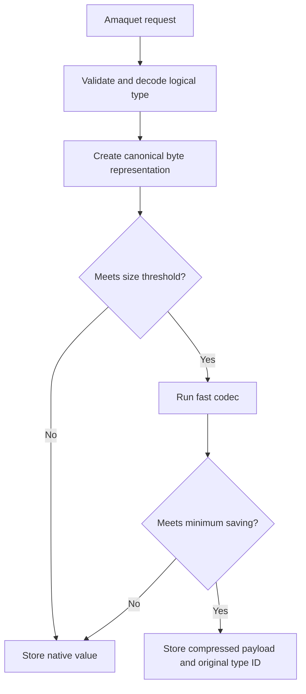
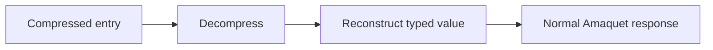

Amaquet can store selected large values in compressed form while preserving their normal Amaquet data type. Compression is part of the Amaquet storage engine. It does not use Redis, an external cache, or a separate database.

## Goals

The compression layer is designed to increase the amount of logical data that can fit in RAM without forcing every operation through a slow, high-ratio codec. It follows four rules:

1. Small values remain uncompressed.
2. Compression is kept only when it clears the configured minimum saving.
3. Decompression is transparent to `GET` and type operations.
4. The original Amaquet type ID remains unchanged.

A compressed key is therefore still reported as `utf8_string`, `json`, `dense_vector`, and so on. Compression is a physical encoding, not a public data type.

## Algorithms

Amaquet chooses or applies one of the following codecs to eligible canonical payloads. Their trade-off is compression ratio versus CPU latency.

### `auto`

Recommended default. Amaquet evaluates its two cheapest codecs:

- **LZ4 block** for general text, JSON, binary payloads, and repeated byte patterns.
- **RLE** for highly repetitive buffers such as zero-filled data.

The smaller candidate is retained only when it meets `min_savings_percent`.

### `lz4`

Uses the built-in LZ4 block codec. It is optimized for low compression and decompression latency. Amaquet stores only the LZ4 block payload because the storage metadata already contains the codec and original byte length.

### `rle`

Run-length encoding. It is useful for long repeated byte runs. It has very low CPU overhead but should not be selected for general natural-language or random data.

### `deflate-fast`

Uses Go's fast DEFLATE mode. It can provide a better ratio for some content, but it costs more CPU than LZ4 or RLE. Select it when RAM pressure matters more than the lowest possible latency.

### `none`

Disables compression while leaving the compression subsystem configured.

## Default configuration

The following JSON enables adaptive compression with the repository's default thresholds.

```json
{
  "compression": {
    "enabled": true,
    "algorithm": "auto",
    "min_bytes": 1024,
    "min_savings_percent": 8
  }
}
```

`min_bytes` is checked before a codec runs. `min_savings_percent` is checked after compression. A 4 KiB value that compresses by only 2% remains raw when the threshold is 8%.

## Environment variables

These variables override the corresponding compression settings after the JSON configuration is loaded. They expose enablement, codec selection, and the minimum payload size; the minimum-savings percentage remains JSON-only.

| Variable                        | Purpose                                                    |
| ------------------------------- | ---------------------------------------------------------- |
| `AMAQUET_COMPRESSION`           | Enable or disable compression. `0` and `false` disable it. |
| `AMAQUET_COMPRESSION_ALGORITHM` | `auto`, `lz4`, `rle`, `deflate-fast`, or `none`.           |
| `AMAQUET_COMPRESSION_MIN_BYTES` | Minimum payload size considered for compression.           |

## Eligible values

Compression is currently applied to payload-oriented values where materialization can be lossless and deterministic:

- contiguous binary strings; chunked blob values remain in their block representation
- UTF-8 strings
- decimals and big decimals when large enough
- big integers when large enough
- JSON documents
- MessagePack
- CBOR
- dense vectors
- sparse vectors
- quantized vectors
- matrix and tensor payloads

Small scalar values, synchronization primitives, active indexes, streams, queues, and other latency-sensitive mutable structures remain in their native representations. This avoids repeatedly rebuilding complex indexes just to save memory.

Collection elements continue to use their native `core.Value` representation. Large top-level payloads receive the largest benefit from the current implementation.

## Write path

For an eligible value, Amaquet performs these steps:



The compressed payload stores the codec name, original byte size, and compressed bytes. TTL, version, timestamps, and key metadata remain outside the compressed payload.

## Read path

`GET` materializes the logical value before it is converted to the Amaquet response. Clients do not need compression support.



Read-only type operations use the same materialization step. When a compressed mutable payload is changed, Amaquet recompresses the resulting value before replacing the stored entry. If the new value no longer meets the saving threshold, it is stored uncompressed.

## Inspecting compression

Use `MEMORY` for one key:

```bash
amaquet-cli -uri amaquet://127.0.0.1:13378 MEMORY '{"key":"large-json"}'
```

A compressed key reports fields similar to:

```json
{
  "key": "large-json",
  "type": "json",
  "compressed": true,
  "algorithm": "lz4",
  "original_bytes": 1048576,
  "stored_bytes": 93421,
  "savings_bytes": 955155,
  "savings_percent": 91.09,
  "version": 1,
  "access_count": 4
}
```

`INFO` includes aggregate compression statistics:

```json
{
  "compression": {
    "compressed_keys": 120,
    "original_bytes": 73400320,
    "stored_bytes": 11848913,
    "savings_bytes": 61551407,
    "savings_percent": 83.86,
    "by_algorithm": {
      "lz4": 117,
      "rle": 3
    }
  }
}
```

These byte counters cover compressed value payloads. They do not claim to measure Go allocator overhead, map buckets, key strings, index structures, or process RSS.

## Choosing settings

For a general-purpose installation, keep `auto`, `min_bytes: 1024`, and `min_savings_percent: 8`.

For very latency-sensitive workloads, increase `min_bytes` to 4 KiB or 16 KiB so only large values are compressed. For memory-constrained workloads with repetitive documents, reduce `min_savings_percent` carefully. For archival-like large blobs where CPU is less important, benchmark `deflate-fast`.

Do not assume compression increases capacity by a fixed factor. Encrypted data, already-compressed images, video, random bytes, and compressed archives often provide little or no saving and will normally remain raw because of the saving threshold.
