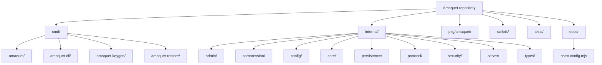

This diagram maps the repository's executable, implementation, client, automation, test, and documentation directories.

The `cmd` directory contains the server, CLI, identity generator, and offline restore executables. `internal` contains the HTTP administration API and state, compression, configuration, sharded core engine, append-only persistence, protocol framing, identity, TCP dispatch, and concrete data structures. `pkg/amaquet` is the public Go client; `scripts`, `tests`, and `docs` contain project automation, integration coverage, and the Astro/Starlight documentation site respectively.

The `internal` boundary prevents external Go packages from depending directly on implementation details. Public applications should use `pkg/amaquet` or implement the Amaquet protocol.
