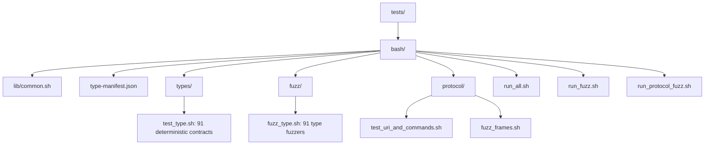

Amaquet includes a black-box Bash contract and a mutation-fuzz entrypoint for **every stable wire data type**. The harness talks to the server through `amaquet-cli`; it does not call Go type methods directly. This tests the same protocol, dispatcher, engine, serialization, TTL, and authorization boundaries used by normal clients.

## Layout

The Bash harness is organized into shared helpers, per-type contracts and fuzzers, protocol checks, and suite runners.



`type-manifest.json` is the machine-readable coverage catalog. The documentation checker requires one deterministic script, one fuzzer, and one Astro reference page for each of its 91 entries.

## Requirements

The harness requires Bash, the Go toolchain when binaries are not already built, and Python 3 for portable helpers. If `jq` is available, scalar JSON extraction uses it because it is much faster. Python remains the fallback, so `jq` is optional.

## Deterministic type suite

Run this suite to exercise the public protocol contract for every stable wire type.

```bash
./tests/bash/run_all.sh
```

The runner starts one isolated Amaquet process on free loopback ports and passes its `AMAQUET_URI` to each type script. Scripts use unique keys and can run concurrently. The default is four workers:

```bash
AMAQUET_TEST_JOBS=8 ./tests/bash/run_all.sh
```

Each contract verifies, as applicable:

1. the documented `SET` or `CREATE` construction path;
2. the exact `TYPE` wire identifier;
3. `EXISTS`;
4. `EXPIRE` and a positive `TTL`;
5. `PERSIST` and the `-1` no-expiry result;
6. one or more meaningful type-specific operations and their results; and
7. `DEL` cleanup.

The tests use current timestamps for retention-sensitive time-series contracts so old synthetic values are not pruned by design.

## Run one type

Invoke an individual contract directly when developing or diagnosing a specific type.

```bash
./tests/bash/types/test_hnsw_index.sh
./tests/bash/types/test_reliable_queue.sh
./tests/bash/types/test_timeseries.sh
```

When `AMAQUET_URI` is not set, an individual script builds missing binaries, starts a disposable local Amaquet process, runs the contract, and removes its temporary state. To inspect a failed local run:

```bash
AMAQUET_KEEP_TMP=1 ./tests/bash/types/test_vector_set.sh
```

The harness prints the temporary directory path through its normal diagnostics. The directory contains the generated configuration, data directory, and `server.log`.

To test an existing server instead:

```bash
AMAQUET_URI=amaquet://127.0.0.1:13378 \
  ./tests/bash/types/test_vector_set.sh
```

## Per-type fuzzing

Every stable data type has a dedicated script:

```bash
AMAQUET_FUZZ_ITERATIONS=100 ./tests/bash/run_fuzz.sh
```

For each iteration, the fuzzer sends a randomized unsupported operation and requires Amaquet to reject it without damaging the key. It then checks that the key remains addressable. Every tenth iteration it resets the key, reconstructs the type, and executes the valid semantic contract. Resetting prevents stateful types such as queues, consumer groups, locks, and streams from producing false failures only because a previous valid iteration changed state.

Run a single type fuzzer:

```bash
AMAQUET_FUZZ_ITERATIONS=1000 ./tests/bash/fuzz/fuzz_vector_set.sh
```

## Raw Amaquet frame fuzzing

The protocol fuzzer works below `amaquet-cli` and opens TCP connections directly:

```bash
AMAQUET_FRAME_FUZZ_ITERATIONS=1000 ./tests/bash/protocol/fuzz_frames.sh
```

It exercises malformed or adversarial frames, including:

- invalid `AMQT` magic;
- unsupported protocol versions;
- invalid frame kinds and opcodes;
- truncated headers and payloads;
- inconsistent declared lengths;
- malformed JSON request payloads;
- random byte sequences;
- randomized request IDs;
- single-byte frame mutation; and
- reconnection after malformed input.

The fuzzer ends with a valid `PING`. A run is not considered successful if the server stops accepting valid protocol traffic.

The combined protocol runner also tests URI and command behavior:

```bash
AMAQUET_FRAME_FUZZ_ITERATIONS=250 ./tests/bash/run_protocol_fuzz.sh
```

## Environment variables

The Bash runners use these variables to select an existing server, tune concurrency, and bound randomized work. Unless a row says otherwise, unset variables use the runner defaults shown below.

| Variable                        | Purpose                                                   | Default           |
| ------------------------------- | --------------------------------------------------------- | ----------------- |
| `AMAQUET_URI`                   | Target an existing server instead of creating a local one | unset             |
| `AMAQUET_BIN`                   | Override the `amaquet` server binary                      | `bin/amaquet`     |
| `AMAQUET_CLI`                   | Override the CLI binary                                   | `bin/amaquet-cli` |
| `AMAQUET_TIMEOUT`               | Per-CLI request timeout                                   | `5s`              |
| `AMAQUET_KEEP_TMP`              | Keep disposable test state when set to `1`                | `0`               |
| `AMAQUET_TEST_JOBS`             | Concurrent type scripts in suite runners                  | `4`               |
| `AMAQUET_FUZZ_ITERATIONS`       | Mutations per type fuzzer                                 | `25` in runner    |
| `AMAQUET_FRAME_FUZZ_ITERATIONS` | Random raw-frame cases                                    | `250`             |

## CI coverage

The main GitHub Actions workflow separates ordinary Go and documentation checks from bounded developer-fuzz and chaos jobs. Across those jobs it runs:

```text
go test ./...
go test -race ./...
go vet ./...
go build ./cmd/amaquet ./cmd/amaquet-cli ./cmd/amaquet-keygen ./cmd/amaquet-restore
./tests/bash/run_all.sh
AMAQUET_FUZZ_ITERATIONS=1 ./tests/bash/run_fuzz.sh
AMAQUET_FRAME_FUZZ_ITERATIONS=50 ./tests/bash/run_protocol_fuzz.sh
AMAQUET_SCENARIO_ITERATIONS=1 ... ./tests/bash/run_scenarios.sh
AMAQUET_SCENARIO_ITERATIONS=1 ... ./tests/bash/run_isolated_fuzz.sh
AMAQUET_GO_FUZZ_TIME=1s ./scripts/run_go_fuzz.sh
... ./tests/bash/run_chaos.sh
AMAQUET_BENCH_TIME=100ms ./scripts/run_benchmarks.sh
python3 docs/scripts/check_docs.py
make docs-build
```

The ellipses stand for the additional bounded environment settings recorded in `.github/workflows/ci.yml`; they are not literal shell arguments. The one-iteration fuzz settings are a smoke layer. The scheduled workflow runs longer chaos, native fuzz, Bash fuzz, and benchmark jobs.

## Scope

The Bash suite is black-box integration coverage. It complements, but does not replace, Go unit tests, the race detector, static analysis, load testing, or Go's native coverage/fuzz tooling.

## Cross-feature developer scenarios

The per-type fuzzers are complemented by 28 cross-feature developer workflow scripts plus isolated security/persistence tests. These cover concurrent clients, malformed arguments, large values, compression transitions, key expiry races, blocking queues, barriers, reliable queue dead-letter behavior, mixed workloads, AOF restart/recovery, RBAC, API-key lifecycle, protocol multiplexing, partial TCP writes, and actual Pub/Sub event delivery.

Run them with:

```bash
AMAQUET_SCENARIO_ITERATIONS=10 ./tests/bash/run_scenarios.sh
./tests/bash/run_isolated_fuzz.sh
```

For the full combined black-box suite:

```bash
./tests/bash/run_developer_fuzz.sh
```

See [Developer workflow fuzzing](developer-fuzzing.md) for the complete matrix, reproduction variables, and release-test recommendations.

## Native Go coverage-guided fuzzing

Seed corpora for eight native Go fuzz targets run under `go test ./...`. To run the coverage-guided engine:

```bash
AMAQUET_GO_FUZZ_TIME=10s ./scripts/run_go_fuzz.sh
```

These targets fuzz protocol frames and URIs, compression/decompression, typed wire decoding, and the core engine lifecycle. Input sizes are bounded inside each fuzz target.
