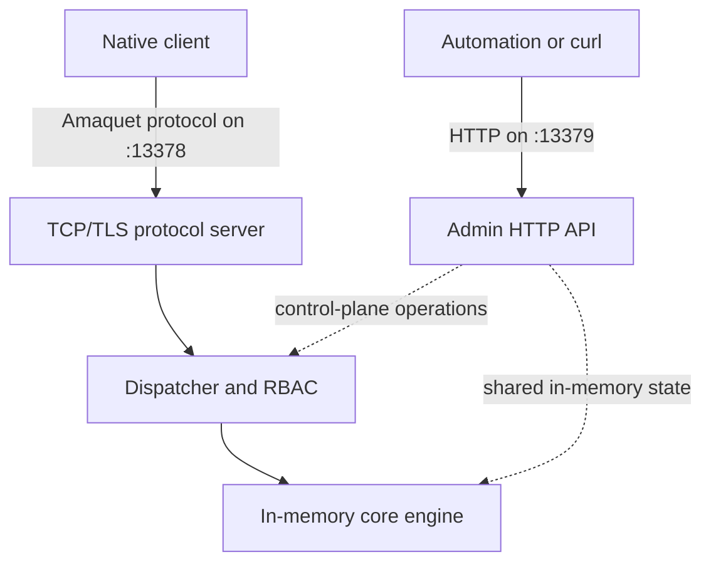

 

Amaquet is a standalone, Redis-like in-memory database written in Go. It does **not** run on Redis and it does not use Redis as a storage backend. The core database stores Amaquet values directly in process memory and exposes them through the Amaquet binary protocol.

The repository includes the database server, a Go client, `amaquet-cli`, an HTTP administration API, optional append-only persistence, API-key authentication, RBAC, Ed25519 protocol identity, Docker deployment assets, deterministic tests, and fuzzing tools.

## Main capabilities

Amaquet combines a typed in-memory data plane with a separate HTTP control plane. The following list summarizes the implemented protocol, storage, persistence, administration, and test surfaces.

- Custom `amaquet://` protocol on TCP and `amaquets://` on TLS.
- 91 stable wire-level data types.
- Strongly typed nested values for collections and messaging structures.
- 256-shard concurrent keyspace with TTL and key versions.
- Optional CRC-protected append-only operation journal.
- Organization, member, API-key, RBAC, system, data-access, and audit administration APIs.
- HTTP administration API for control-plane operations and metrics.
- Per-type Bash test and fuzz entrypoints plus raw-frame fuzzing.

## Where to start

Read these pages in order for a first installation; operators and client authors can then branch into the architecture, persistence, and protocol references that match their work.

1. [Install Amaquet](getting-started/installation.md).
2. Follow the [quick start](getting-started/quickstart.md).
3. Read the [configuration reference](getting-started/configuration.md).
4. Review the [data-type catalog](data-types/index.md).
5. Read the [Amaquet protocol](protocol/overview.md) if you are building a client.
6. Review [architecture](concepts/architecture.md) and [persistence](concepts/persistence.md) before production deployment.

## Process model

Amaquet exposes a TCP/TLS data-plane listener and a separate HTTP control-plane listener:

The administration API is a control-plane surface. It is not used as a backing data store.
