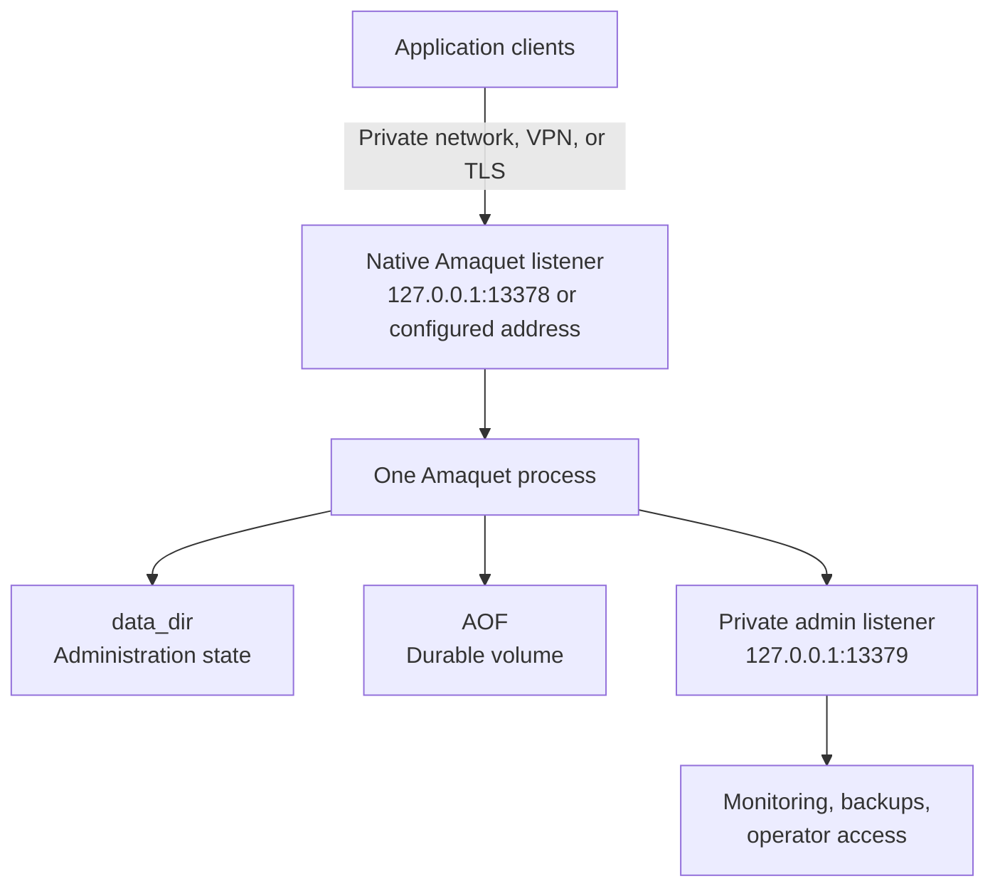
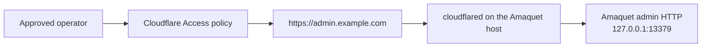

Amaquet is a single-node, stateful in-memory database with optional append-only persistence, an HTTP administration listener, and a native TCP protocol listener. This page explains how to deploy that process safely in production infrastructure.

The most important deployment fact is that Amaquet does not currently provide distributed replication, consensus, read replicas, or active-active clustering. A production deployment therefore has one active Amaquet writer and uses durable storage, checkpoints, backups, and an external supervisor for recovery.

## Deployment model and constraints

Treat Amaquet as one stateful process, not as a stateless web replica.

| Component | Default | Production responsibility |
| --- | --- | --- |
| Native protocol | `127.0.0.1:13378` | Application data traffic. Use `amaquets://` and TLS when it crosses a trust boundary. |
| Admin HTTP API | `127.0.0.1:13379` | Health, readiness, metrics, administration, configuration, and persistence operations. Keep it private or protect it with HTTPS and authentication. |
| `data_dir` | `./data` | Administration state, bootstrap-token material, upload spools, checkpoints, and runtime files. Put it on persistent storage. |
| AOF | Disabled by default | Enable it when restart recovery is required. Put it on durable storage and monitor its health. |
| Process supervision | None in the binary | Use the Debian `amaquetd` unit, systemd, Docker Compose, Kubernetes, or another supervisor. |
| Replication | Not provided | Use one active writer and a tested backup or cold-standby recovery procedure. |

Do not start two Amaquet processes against the same `data_dir` or AOF path. The AOF is a single-writer journal; a load balancer in front of multiple independent instances does not create replication and can send clients to inconsistent keyspaces.

## Recommended topology

The default topology is one Amaquet process on one VM or one stateful container with a persistent volume:



Keep the native and admin listeners separate in network policy. An application that only needs data operations should not receive administration credentials or access to the admin API.

A deployment should provide:

- one active Amaquet process for each data set;
- durable storage for `data_dir` and the AOF;
- a service account that is not root;
- TLS for traffic that leaves a trusted local boundary;
- API keys for machine clients after bootstrap;
- firewall or security-group rules that limit both listeners;
- liveness, readiness, logs, disk, memory, and AOF-health monitoring;
- online checkpoints and an offline restore drill;
- a documented upgrade and rollback procedure.

## Choose a hosting pattern

Use the simplest stateful platform that meets the workload and recovery requirements.

| Pattern | Recommended use | Important limitation |
| --- | --- | --- |
| Debian/Ubuntu VM with systemd | Default production choice for one node. | You manage the VM, storage, patching, and backups. |
| AWS EC2 with EBS | AWS deployment with block storage and direct OS control. | One active instance should own the volume. |
| Google Compute Engine with Persistent Disk | GCP deployment with a VM and systemd. | Keep the disk and VM in compatible zones and plan failover. |
| VPS provider with a block volume | Small production or development deployment. | Provider snapshots are not a substitute for application-aware recovery tests. |
| Docker Compose | One host, reproducible image, or private environment. | Container storage is ephemeral unless `/app/data` is mounted. |
| Kubernetes StatefulSet | Teams already operating Kubernetes. | Use one replica and a persistent volume; a Deployment with multiple replicas is not an Amaquet cluster. |
| Cloudflare Tunnel | Private or identity-protected access to the admin API, or controlled TCP access. | Cloudflare Tunnel is an access path, not compute, storage, replication, or backup. |
| Serverless request platform | Usually not suitable for Amaquet itself. | Custom long-lived TCP and durable local state are not the normal execution model. |

## Configuration and storage principles

Amaquet loads compiled defaults, the JSON file passed to `--config`, supported `AMAQUET_*` environment overrides, and then validates the merged configuration. Relative paths are resolved from the process working directory, so service deployments should use absolute paths.

A durable Linux configuration has this shape:

```json
{
  "protocol": {
    "host": "10.0.10.15",
    "port": 13378,
    "tls": true,
    "tls_cert_file": "/etc/amaquet/tls/protocol.crt",
    "tls_key_file": "/etc/amaquet/tls/protocol.key",
    "require_auth": true,
    "allow_insecure_auth": false
  },
  "admin": {
    "host": "127.0.0.1",
    "port": 13379,
    "tls": false,
    "metrics_require_auth": true
  },
  "security": {
    "bootstrap_token": "",
    "public_key_file": "/etc/amaquet/identity/public.pem",
    "private_key_file": "/etc/amaquet/identity/private.pem"
  },
  "persistence": {
    "aof_enabled": true,
    "aof_path": "/var/lib/amaquet/amaquet.aof",
    "fsync": "everysec"
  },
  "limits": {
    "max_connections": 2000,
    "max_memory_bytes": 6442450944,
    "eviction_policy": "noeviction"
  },
  "data_dir": "/var/lib/amaquet"
}
```

This is a shape to adapt, not a copy-and-run production secret or certificate configuration. Use real certificate paths, a secret-management method, and capacity values appropriate to the host.

### Listener placement

The native listener carries application data and the admin listener carries control-plane operations.

- Keep `admin.host` on loopback or a private management interface whenever possible.
- If `protocol.host` is non-loopback and authentication is enabled, use `protocol.tls:true`.
- If `admin.host` is non-loopback, use `admin.tls:true`.
- Do not expose port `13379` publicly merely because `/api/health` is useful.
- Use an authenticated API key for `/metrics` when `admin.metrics_require_auth` is true.
- Treat `protocol.allow_insecure_auth` and `admin.allow_insecure` as isolated-network escape hatches, not production security controls.

See [Configuration](../reference/configuration.md), [TLS and protocol identity](tls.md), and [Authentication and identity](../protocol/authentication.md).

### Persistence and storage

AOF persistence records committed mutations for restart recovery. It does not make the in-memory engine fully disk-backed and does not replace backups.

Put these items on persistent, protected storage:

- `data_dir/admin.json`;
- the active AOF;
- checkpoint files;
- the bootstrap-token file while bootstrap is active;
- TLS private keys and certificates;
- optional Ed25519 identity keys;
- upload and recovery state that must survive a restart.

Use absolute `persistence.aof_path` and `data_dir` values in service deployments. Do not place the AOF on an ephemeral container layer, temporary directory, or shared filesystem that allows more than one Amaquet writer.

Use `fsync:"everysec"` for the usual durability/latency balance, `always` for stronger acknowledged-write durability at higher latency, and `no` only when the crash-loss tradeoff is intentional.

### Memory and capacity

The engine stores active values in memory. Set `limits.max_memory_bytes` below the machine or container memory limit and leave headroom for the Go runtime, connections, indexes, AOF buffers, uploads, TLS, and the operating system.

The configured memory value is an engine-data budget, not an exact RSS limit. Monitor process RSS as well as Amaquet's `INFO`, `/metrics`, and `MEMORY` information.

Set `limits.max_connections`, in-flight request limits, `max_payload_bytes`, and upload limits according to client pools and expected concurrency. Make the host file-descriptor limit larger than the maximum connection count plus persistence and operating-system overhead.

## Bootstrap and credentials

A new deployment needs one initial administrative credential. Prefer an empty `security.bootstrap_token` with a protected `data_dir`; Amaquet then creates `data_dir/bootstrap-token` with restrictive permissions on first normal startup and logs its path rather than the secret.

The bootstrap flow is:

1. Start Amaquet with the protected configuration.
2. Read the bootstrap token from the protected file or one-time initialization output.
3. Use it to create a permanent administrator API key.
4. Store the API-key secret in a secret manager.
5. Remove bootstrap credentials from routine automation.
6. Confirm that bootstrap authentication is disabled after the first administrator key is created.

Do not put bootstrap or API-key secrets in a public image, Git repository, Terraform state file, user-data script, Kubernetes manifest, or shell history. Use AWS Secrets Manager/SSM Parameter Store, Google Secret Manager, Kubernetes Secrets with appropriate controls, or an equivalent system.

## Debian or Ubuntu with systemd

The release `.deb` is the simplest Linux deployment. It installs the binaries, the `amaquetd` systemd unit, `/etc/amaquet/amaquet.json`, a dedicated `amaquet` system user, and `/var/lib/amaquet`.

Install the architecture-matching package:

```bash
sudo apt install ./amaquet_VERSION_amd64.deb
```

The packaged service is intentionally not started or enabled during package installation. Start and enable it explicitly:

```bash
sudo systemctl daemon-reload
sudo systemctl enable --now amaquetd
sudo systemctl status amaquetd
```

Read the first-start bootstrap token:

```bash
sudo cat /var/lib/amaquet/bootstrap-token
```

The packaged service uses loopback listeners, AOF at `/var/lib/amaquet/amaquet.aof`, and the unprivileged `amaquet` user. Edit `/etc/amaquet/amaquet.json` as root, provision TLS and identity files with correct ownership, and restart after changes:

```bash
sudoedit /etc/amaquet/amaquet.json
sudo systemctl restart amaquetd
sudo journalctl -u amaquetd --no-pager
```

Check liveness and readiness from the host:

```bash
curl --fail http://127.0.0.1:13379/api/health
curl --fail http://127.0.0.1:13379/api/ready
```

`/api/ready` also reflects AOF persistence health. A failed AOF flush or fsync makes the service not ready, so do not route application traffic to a node that fails readiness.

Stop or disable the service with:

```bash
sudo systemctl stop amaquetd
sudo systemctl disable amaquetd
```

For source-built deployments, use the same service properties: absolute paths, a fixed working directory, a non-root user, persistent storage, `Restart=on-failure`, and a graceful-stop timeout of at least 30 seconds. The release package's unit is the reference implementation for the package layout.

## AWS deployment

AWS offers several ways to host Amaquet, but the stateful storage decision is more important than the compute product. The default AWS design is one Linux EC2 instance, one durable EBS data volume, and systemd.

### EC2 and EBS

Use a private subnet unless public access is unavoidable, an EC2 instance sized for the engine and process headroom, an encrypted EBS data volume mounted at `/var/lib/amaquet`, security groups limited to application and management networks, and an IAM role rather than long-lived cloud credentials.

AWS describes EBS as persistent block storage for EC2 in the [EBS storage guide](https://docs.aws.amazon.com/AWSEC2/latest/UserGuide/storage_ebs.html) and documents snapshot backups in the [EBS snapshots guide](https://docs.aws.amazon.com/en_en/ebs/latest/userguide/ebs-snapshots.html).

A safe sequence is:

1. Create the VPC, private subnet, route policy, and security groups.
2. Create an encrypted EBS data volume in the instance's Availability Zone.
3. Attach, format, and mount it at `/var/lib/amaquet`.
4. Install the matching `.deb`.
5. Set `data_dir` and `persistence.aof_path` to the mounted volume.
6. Provision TLS and identity files with restrictive permissions.
7. Start `amaquetd` and verify health, readiness, logs, and an authenticated request.
8. Store permanent API keys in AWS Secrets Manager or SSM Parameter Store.
9. Schedule Amaquet checkpoints and EBS snapshots, then test restoration on a separate instance or volume.

A security-group shape is:

| Traffic | Source | Destination |
| --- | --- | --- |
| Native TCP | Application security group or private CIDR | `13378` |
| Admin HTTP/HTTPS | Operations or monitoring security group only | `13379` |
| SSH | Prefer a controlled bastion or Systems Manager | `22` |

Do not open `13378` or `13379` to `0.0.0.0/0` without a reviewed design. A security group does not replace Amaquet authentication or TLS.

### ECS and Fargate

Amaquet can run in a container, but the task writable layer is not durable. Use an external volume and one active task.

AWS documents EFS, EBS, and other storage options in [ECS storage best practices](https://docs.aws.amazon.com/us_eg/AmazonECS/latest/bestpracticesguide/storage.html). EFS is persistent shared storage but its network filesystem latency must be measured against AOF. EBS is block storage suited to low-latency single-writer persistence, but verify the exact lifecycle behavior for the ECS launch mode.

For ECS:

- use one Amaquet task for each data set;
- inject secrets through Secrets Manager or SSM;
- place the task in private subnets;
- restrict its security group;
- never use Fargate ephemeral storage as the recovery volume;
- do not mount one AOF into multiple tasks;
- use a TCP-capable load-balancing path only when the native listener must be reached from another network;
- keep the admin endpoint private or separately authenticated.

For a first AWS deployment, EC2 plus EBS is easier to recover and reason about than a stateful ECS service.

### EKS

Run Amaquet as a one-replica `StatefulSet` with a `PersistentVolumeClaim`, not as a horizontally scaled `Deployment`. Use one single-writer block volume, retain the PVC during pod replacement, probe `/api/ready`, and allow at least 30 seconds for graceful termination.

A Kubernetes controller can restart or reschedule the pod, but it does not provide Amaquet replication. Test volume reattachment, snapshot restore, and a cold-start recovery before relying on the design.

## Google Cloud Platform deployment

The simplest GCP deployment is one Compute Engine VM with a Persistent Disk mounted for Amaquet state and a systemd-managed process. See Google's [Persistent Disk documentation](https://docs.cloud.google.com/compute/docs/disks/persistent-disks).

### Compute Engine and Persistent Disk

Use a private VPC address for the native listener, firewall rules limited to application and management networks, a Persistent Disk mounted at `/var/lib/amaquet`, Secret Manager for credentials, and scheduled disk snapshots plus Amaquet checkpoints.

The deployment sequence is:

1. Create a VM with enough memory for the configured engine budget and process headroom.
2. Create or attach a Persistent Disk in a compatible zone.
3. Format and mount it at `/var/lib/amaquet`.
4. Install the matching `.deb`.
5. Set absolute data and AOF paths.
6. Set ownership so the `amaquet` user can write the volume.
7. Provision TLS certificates and optional identity keys.
8. Enable `amaquetd`, create a permanent API key, and verify readiness.
9. Test restoring a disk or checkpoint on a separate VM.

Do not make port `13379` public merely to let monitoring reach it. Prefer private monitoring, Cloud VPN, or an authenticated HTTPS path.

### Google Kubernetes Engine

GKE supports stateful workloads with PersistentVolumes, PersistentVolumeClaims, and StatefulSets. Google's [stateful application guide](https://docs.cloud.google.com/kubernetes-engine/docs/how-to/stateful-apps) and [persistent-volume guidance](https://docs.cloud.google.com/kubernetes-engine/docs/concepts/persistent-volumes) describe this model.

Use one Amaquet replica, one PVC, and a private Service. Mount the PVC at `data_dir`, inject secrets through a secret manager, and use a ConfigMap or mounted file for non-secret configuration and TLS paths.

Use:

- liveness probe: `GET /api/health`;
- readiness probe: `GET /api/ready`;
- authenticated metrics scraping: `GET /metrics`;
- explicit PVC retention and snapshot policy;
- a termination grace period of at least 30 seconds.

Do not add replicas expecting a distributed Amaquet cluster. A GKE controller preserves a pod's volume; it does not replicate Amaquet state.

### GCP serverless products

Cloud Run, Cloud Functions, and similar request-oriented runtimes are not the default place for the Amaquet server. Amaquet needs a long-lived custom TCP listener and a durable single-writer data directory. Use Compute Engine or GKE for Amaquet; use serverless products as clients or API layers when their networking and timeout model fits.

## Cloudflare Tunnel

Cloudflare Tunnel is useful for reaching a private Amaquet deployment without opening inbound firewall ports. It is an outbound connector and access path; it does not host Amaquet, persist its AOF, provide replication, or replace Amaquet authentication.

Cloudflare's [Tunnel setup guide](https://developers.cloudflare.com/tunnel/get-started/) requires a Cloudflare account, a domain, and a server or VM where `cloudflared` can run. Review the [Tunnel firewall and connectivity requirements](https://developers.cloudflare.com/tunnel/configuration/).

### Protect the admin API

For operator access, keep Amaquet's admin listener on loopback and publish it through an Access-protected tunnel route:



A conceptual `cloudflared` ingress configuration is:

```yaml
tunnel: TUNNEL-UUID
credentials-file: /etc/cloudflared/TUNNEL-UUID.json

ingress:
  - hostname: admin.example.com
    service: http://127.0.0.1:13379
  - service: http_status:404
```

Create the tunnel and DNS route through the Cloudflare dashboard or current `cloudflared` commands. Install `cloudflared` as its own service and protect its credential file.

Then:

1. Create an Access policy for approved operators.
2. Keep Amaquet admin authentication enabled.
3. Use an admin API key for API calls even when Access protects the hostname.
4. Monitor both `cloudflared` and Amaquet `/api/ready`.
5. Do not assume that a successful Access login proves the Amaquet bearer token is valid.

### Native TCP through Cloudflare

The native listener is arbitrary TCP, not HTTP. Cloudflare documents TCP routes, but clients normally need `cloudflared` locally. A conceptual route is:

```yaml
ingress:
  - hostname: amaquet-tcp.example.com
    service: tcp://127.0.0.1:13378
  - service: http_status:404
```

The client creates a local endpoint:

```bash
cloudflared access tcp --hostname amaquet-tcp.example.com --url 127.0.0.1:13378
```

The Amaquet client then connects to the local endpoint:

```bash
./bin/amaquet-cli -uri amaquet://127.0.0.1:13378 -api-key "$AMAQUET_API_KEY" PING '{}'
```

See Cloudflare's [routing documentation](https://developers.cloudflare.com/tunnel/concepts/routing/) and [arbitrary TCP guide](https://developers.cloudflare.com/cloudflare-one/access-controls/applications/non-http/cloudflared-authentication/arbitrary-tcp/). For long-lived native connections, prefer a private network, VPN, Cloudflare private-network connectivity, or current Client-to-Tunnel guidance.

If clients cannot install `cloudflared`, use a private network/VPN or investigate an L4 product such as Spectrum for the exact account and protocol requirements. Do not publish port `13378` as an HTTP service.

A tunnel does not make plaintext native traffic safe on an untrusted client path. Use Amaquet TLS when the native connection crosses a trust boundary. Quick Tunnels are for temporary development access, not production database exposure.

## VPS providers

A VPS is a good fit when one Linux host and one durable volume are sufficient. This pattern applies to DigitalOcean Droplets, Akamai/Linode, Vultr, Hetzner Cloud, OVHcloud, Lightsail, and similar providers.

Choose a Debian or Ubuntu image, install the matching `.deb`, and use systemd:

```bash
sudo apt install ./amaquet_VERSION_amd64.deb
sudo systemctl enable --now amaquetd
sudo systemctl status amaquetd
```

Attach a provider block volume when available and mount it at `/var/lib/amaquet` before enabling the service. DigitalOcean documents its block-volume workflow in [Volumes: create and set up](https://docs.digitalocean.com/products/volumes/how-to/create/). Other providers use different device names and mount automation, so follow the provider's current storage instructions and verify the mount before starting Amaquet.

Use both provider firewall rules and the host firewall:

```bash
sudo ufw default deny incoming
sudo ufw default allow outgoing
sudo ufw allow from 10.20.0.0/16 to any port 13378 proto tcp
sudo ufw allow from 10.20.0.0/16 to any port 13379 proto tcp
sudo ufw enable
```

Replace the CIDR with the actual application and management networks. If clients are not on a private network, use TLS and a carefully restricted VPN or proxy design instead of opening the native port broadly.

Provider snapshots are useful for disaster recovery but may capture a live database filesystem. Prefer an Amaquet checkpoint followed by a coordinated filesystem snapshot, and restore the result on a separate test host. Keep a copy outside the VPS provider or region for a real disaster-recovery plan.

## Docker and container hosts

The repository's Docker image runs as the unprivileged `amaquet` user. The development Compose file publishes both ports only on loopback and enables explicit insecure-listener overrides because the container binds to `0.0.0.0` internally. Do not reuse that profile for a public deployment.

For production Compose:

1. Build or pull an immutable image.
2. Mount `/app/data` from durable storage.
3. Provide production JSON with absolute paths.
4. Inject `AMAQUET_BOOTSTRAP_TOKEN` through the deployment secret mechanism.
5. Mount protocol/admin certificates and identity keys read-only.
6. Publish only the listener required by the application network.
7. Set a restart policy and stop grace period of at least 30 seconds.
8. Run exactly one Amaquet container for each data set.

The repository production template uses AOF at `/app/data/amaquet.aof`, separate protocol/admin TLS files, and a named data volume. The writable container layer is not a backup. Never scale multiple containers against one AOF or shared `data_dir`.

## Kubernetes and other orchestrators

Kubernetes is appropriate when the organization already operates stateful workloads there. Use a `StatefulSet`, not a stateless `Deployment`, for the single Amaquet pod.

The required design is:

- one replica;
- one persistent volume mounted at `data_dir`;
- one internal Service for native traffic;
- a separate restricted path for the admin API;
- ConfigMap or mounted file for non-secret configuration;
- Secret or external secret manager for bootstrap/API/TLS material;
- liveness probe on `/api/health`;
- readiness probe on `/api/ready`;
- graceful termination of at least 30 seconds;
- volume snapshots and an Amaquet checkpoint schedule.

For a `ReadWriteOnce` block volume, do not configure rollout behavior that leaves old and new pods competing for the volume. Scale the StatefulSet to zero before a manual restore or storage migration, and do not delete the PVC until the backup is verified.

Nomad, Docker Swarm, and other orchestrators follow the same rule: one allocation, one mounted durable volume, one active writer, and a supervisor that does not silently create a second writer during replacement.

## Reverse proxies and load balancers

The admin API is HTTP and can be placed behind an HTTPS reverse proxy such as Nginx, Caddy, an AWS ALB, or an equivalent layer. Preserve the authentication header and restrict the upstream to the management network.

The native protocol is custom TCP. A normal HTTP reverse proxy cannot carry it. Use direct `amaquets://` access over a private network, a TCP-capable load balancer, a VPN, or a Cloudflare TCP/client tunnel with its client requirements.

Do not put multiple independent Amaquet instances behind a round-robin load balancer. A replacement node must own the correct persistent volume and recover the correct AOF before accepting traffic.

## Backups and disaster recovery

Use both an Amaquet-aware checkpoint and an infrastructure backup.

Create an online checkpoint with an administrator credential that has the required persistence permission:

```bash
curl --fail --silent --show-error -X POST \
  -H "Authorization: Bearer $AMAQUET_ADMIN_TOKEN" \
  -H "Content-Type: application/json" \
  --data '{"name":"checkpoint-production.aof"}' \
  https://admin.example.com/api/persistence/checkpoint
```

The endpoint creates a verified recovery image under `data_dir/backups` when AOF is enabled. Copy it to independent object storage such as S3 or Google Cloud Storage.

Protect these items together:

- the checkpoint or active AOF;
- `data_dir/admin.json`;
- the configuration;
- TLS certificates and private keys;
- optional Ed25519 identity keys;
- the bootstrap-token file while bootstrap is active.

Restore only while Amaquet is stopped:

```bash
sudo systemctl stop amaquetd
sudo -u amaquet /usr/bin/amaquet-restore -source /backups/checkpoint-production.aof -target /var/lib/amaquet/amaquet.aof
sudo systemctl start amaquetd
sudo systemctl status amaquetd
```

Preserve the original file until the restored server passes readiness and application-level checks. See [Backup and recovery](backups.md).

## Health and observability

Use the three admin surfaces deliberately:

| Endpoint | Purpose | Authentication |
| --- | --- | --- |
| `/api/health` | Process liveness. | Usually public only on a private admin listener. |
| `/api/ready` | Readiness, including persistence health and basic statistics. | Same listener policy as the admin API. |
| `/metrics` | Prometheus-format metrics. | Requires `system.read` by default. |

Alert on:

- readiness failures and `amaquet_ready 0`;
- AOF flush/fsync errors;
- process RSS approaching the host limit;
- engine memory approaching `max_memory_bytes`;
- data-volume usage and inode exhaustion;
- upload-spool growth;
- repeated service restarts;
- authentication failures;
- missing or stale checkpoints.

Collect systemd journal, container, or orchestrator logs centrally. Amaquet logs startup addresses, persistence replay/open status, identity information, configuration failures, and shutdown signals.

## Upgrades and rollback

Upgrade one active node at a time:

1. Verify the new package or image in staging.
2. Create and export an Amaquet checkpoint.
3. Back up `admin.json`, configuration, keys, and the storage volume.
4. Stop the service gracefully.
5. Install the new package or image.
6. Start exactly one instance.
7. Wait for `/api/ready`.
8. Run authenticated `PING`, `INFO`, type-registry, and application smoke tests.
9. Review replay and persistence logs.
10. Retain the previous package or image until validation completes.

If startup fails during replay, stop the process, preserve the AOF and logs, and restore into a separate data directory or volume first. Do not repeatedly restart a node with a suspected corrupt journal while discarding evidence.

## Deployment anti-patterns

Avoid these designs:

- two Amaquet processes sharing one AOF or `data_dir`;
- multiple replicas behind a load balancer without external replication;
- ephemeral container storage for AOF or `admin.json`;
- public unauthenticated admin HTTP;
- plaintext native traffic over the public Internet;
- secrets in images, repositories, Terraform state, or command-line arguments;
- a provider snapshot as the only backup;
- restoring an AOF while the server is running;
- a stateless serverless runtime as the primary Amaquet host;
- an HTTP-only reverse proxy for the native TCP protocol;
- `fsync:"no"` without documenting crash-loss behavior;
- `max_memory_bytes` equal to total host RAM.

## Provider-independent deployment checklist

Before declaring a deployment complete, verify:

- [ ] Exactly one active Amaquet writer owns the data.
- [ ] `data_dir` and AOF are on durable storage.
- [ ] Native and admin listeners are separately firewalled.
- [ ] Native TLS is enabled outside the trusted local boundary.
- [ ] Admin HTTPS or a private management path is in place.
- [ ] The process runs as a non-root user.
- [ ] A permanent API key has replaced bootstrap access for automation.
- [ ] `/api/health` and `/api/ready` are monitored.
- [ ] `/metrics` is scraped with `system.read` authorization.
- [ ] Checkpoints are copied to independent storage.
- [ ] A restore has been tested on a clean host, VM, container, or volume.
- [ ] Upgrade, rollback, and incident contacts are documented.
- [ ] Firewall, secret, storage, and snapshot policies have been reviewed.

Continue with [Docker](docker.md), [TLS and protocol identity](tls.md), [Backup and recovery](backups.md), [Observability](observability.md), and [Production hardening](production-hardening.md).
